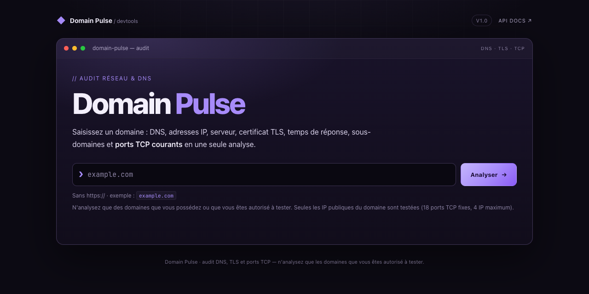
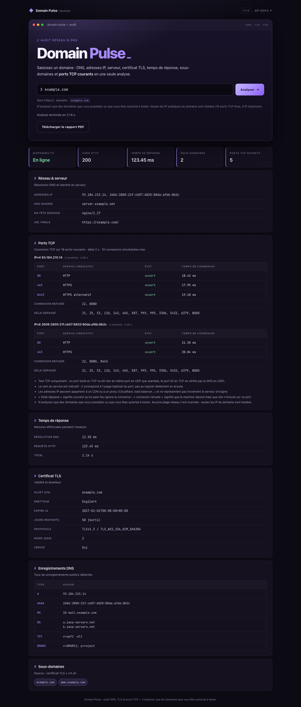
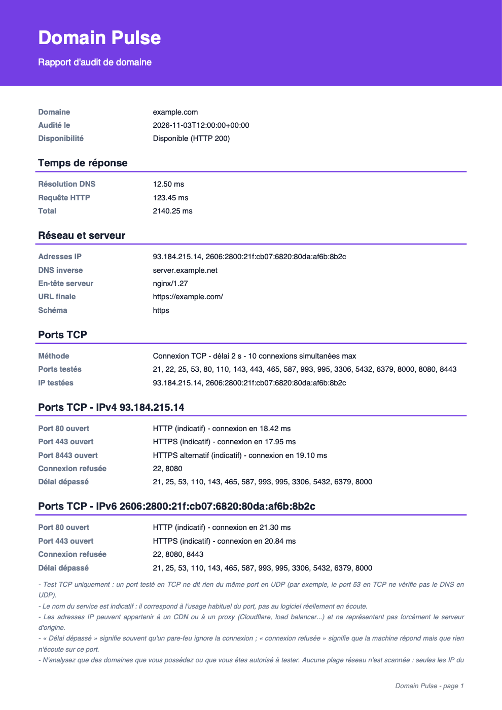
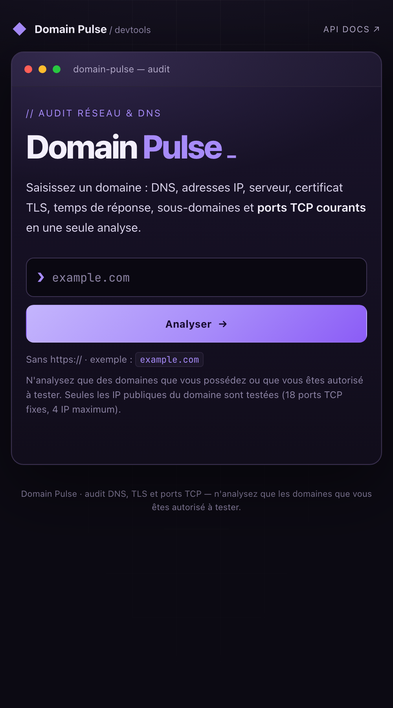

# Domain Pulse

Audit rapide d'un nom de domaine : DNS, adresses IP, identité du serveur,
certificat TLS, temps de réponse, sous-domaines, scan de ports et export PDF.

## Captures d'écran

> Captures réalisées avec des données de démonstration (analyse simulée de
> `example.com`, aucun scan réel).

### Accueil

Un seul champ : le domaine. Pas d'IP ni de ports à saisir.



### Résultats d'une analyse

Disponibilité, réseau, **ports TCP par IP** (ouvert / connexion refusée / délai
dépassé), temps de réponse, certificat TLS, DNS et sous-domaines.



### Rapport PDF et version mobile

<p>
  
  &nbsp;
  
</p>

## Fonctionnalités

- **Tous les enregistrements DNS publics** : `A`, `AAAA`, `CNAME`, `MX`, `NS`,
  `TXT`, `SOA`, `CAA`, `SRV`, `HTTPS` et `DMARC`.
- **Adresses IP** IPv4 et IPv6, avec **DNS inverse** (PTR).
- **Identité du serveur** : en-tête HTTP `Server`, IP principale, nom PTR.
- **Temps de réponse** : résolution DNS, requête HTTP et durée totale.
- **Certificat TLS** : sujet, émetteur, expiration, jours restants, protocole,
  chiffrement et noms alternatifs (SAN).
- **Sous-domaines** : certificat TLS + journaux de certificats (crt.sh) +
  vérification de préfixes courants (`www`, `api`, `mail`, `dev`, ...).
- **Disponibilité fiable** : essai HTTPS, puis HTTPS sans vérification du
  certificat (si le certificat est invalide), puis HTTP. Toute réponse HTTP
  (même `403` ou `404`) est considérée comme « joignable ».
- **Ports TCP courants, automatiquement** : l'utilisateur saisit seulement le
  domaine. Ses IP publiques (IPv4 et IPv6, 4 maximum) sont testées sur 18 ports
  fixes : 21, 22, 25, 53, 80, 110, 143, 443, 465, 587, 993, 995, 3306, 5432,
  6379, 8000, 8080, 8443. Résultat par IP : ouvert (avec temps de connexion),
  connexion refusée ou délai dépassé. Délai 2 s, 10 connexions simultanées max.
- **Export PDF** de l'analyse affichée (ports compris), sans relancer le scan.
- Cache mémoire de 5 minutes et protection contre les cibles non publiques.

## Endpoints

| Méthode | Route | Description |
| --- | --- | --- |
| `GET` | `/` | Interface web |
| `GET` | `/health` | Sonde de disponibilité |
| `GET` | `/check?domain=example.com` | Audit complet en JSON |
| `GET` | `/check?domain=example.com` → champ `ports` | Résultat du scan TCP |
| `GET` | `/report.pdf?domain=example.com` | PDF de la dernière analyse (404 si aucune analyse récente) |

Options communes :

- `refresh=true` : ignore le cache de 5 minutes.
- `DNS_RESOLVERS` (variable d'environnement) : liste de résolveurs DNS séparés
  par des virgules. Par défaut : `1.1.1.1,8.8.8.8,9.9.9.9`. Le résolveur
  système est utilisé en secours.

Le PDF reprend l'analyse gardée en mémoire (1 heure) : il ne relance ni l'audit
ni le scan des ports.

```bash
# Audit JSON
curl "http://localhost:8000/check?domain=example.com"

# Rapport PDF de cette analyse (à appeler après /check)
curl -OJ "http://localhost:8000/report.pdf?domain=example.com"
```

## Lancer le projet

```bash
uv sync
uv run uvicorn main:app --reload
```

L'application écoute sur <http://localhost:8000>.

## Tests et qualité

```bash
uv run python -m pytest -v
```

La CI GitHub Actions est dans `.github/workflows/ci.yaml` (tests puis build et
publication de l'image Docker).

## Docker

```bash
docker build -t domain-pulse .
docker run --rm -p 8000:8000 domain-pulse
```

L'image tourne avec un utilisateur non privilégié et expose un `HEALTHCHECK`
sur `/health`.

## Notes

- Les sous-domaines dépendent de sources externes (crt.sh) : en cas
  d'indisponibilité, l'outil se rabat sur le certificat TLS et des préfixes
  courants.
- Les domaines privés (`localhost`, `.local`, `.internal`) et les adresses IP
  littérales sont refusés. Les IP non publiques (privées, locales, réservées,
  CGNAT, multicast) ne sont jamais contactées : ni HTTP, ni TLS, ni ports.
- Le scan de ports est **TCP uniquement** : tester le port 53 en TCP ne vérifie
  pas le DNS en UDP. Le nom du service est indicatif.
- Les IP d'un domaine peuvent appartenir à un CDN ou à un proxy : elles ne
  représentent pas forcément le serveur d'origine.
- Aucune plage réseau n'est scannée, seulement les IP du domaine saisi.
  N'analysez que des domaines que vous possédez ou que vous êtes autorisé à
  tester.
- Les tests simulent toutes les connexions TCP : la CI ne fait aucun scan réel.
- La vérification de disponibilité accepte toute réponse HTTP, même `403` ou
  `404` : `reachable` indique que le serveur répond, `status_ok` indique un code
  `200-399`.
- Le résultat est mis en cache 5 minutes pour éviter de solliciter les sources
  externes à chaque appel.
